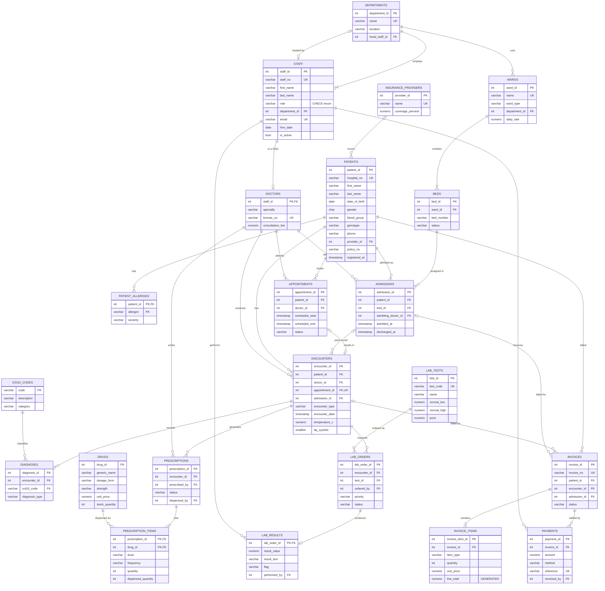

# ER Diagram — St. Grace Specialist Hospital

The diagram below uses crow's-foot notation (Mermaid `erDiagram`). It renders on GitHub
and in VS Code. The raw source is `diagrams/er-diagram.mmd`: paste it into https://mermaid.live and use Actions > PNG to export `diagrams/er-diagram.png`. pgAdmin (right-click the database > ERD For Database) gives a second, auto-generated diagram for `screenshots/`.

- `||--o{` one to zero-or-many
- `||--|{` one to one-or-many
- `|o--o{` zero-or-one to zero-or-many
- `||--o|` one to zero-or-one

## Design decisions shown in the diagram

| Decision | Why |
|---|---|
| **Specialisation (ISA):** `DOCTORS` is a subtype of `STAFF` | Only doctors have a licence, specialty and fee. Putting those columns on `STAFF` would leave them NULL for about 80% of rows. |
| **Weak entity:** `PATIENT_ALLERGIES` | An allergy has no meaning without its patient. Its key is `(patient_id, allergen)`, and rows are deleted with the patient (`ON DELETE CASCADE`). |
| **Associative entity:** `PRESCRIPTION_ITEMS` | Resolves the many-to-many between `PRESCRIPTIONS` and `DRUGS` and stores attributes of the link (dose, frequency, quantity). |
| **1 : 0..1** `LAB_ORDERS` → `LAB_RESULTS` | A result exists only after the test is done, so pending orders don't carry empty result columns. |
| **1 : 0..1** `APPOINTMENTS` → `ENCOUNTERS` | A no-show or cancelled appointment produces no encounter. Walk-in emergency encounters have no appointment. `UNIQUE(appointment_id)` enforces "at most one". |
| **Circular reference** `DEPARTMENTS.head_staff_id` ↔ `STAFF.department_id` | Resolved with a `DEFERRABLE INITIALLY DEFERRED` foreign key, so a department and its head can be created in the same transaction. |
| **Central `ENCOUNTERS` entity** | Every clinical event (diagnosis, prescription, lab order, bill) hangs off one visit. That makes patient-history queries a single join path. |
